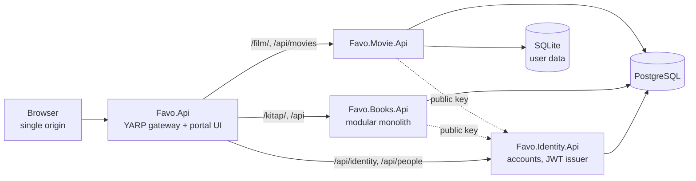
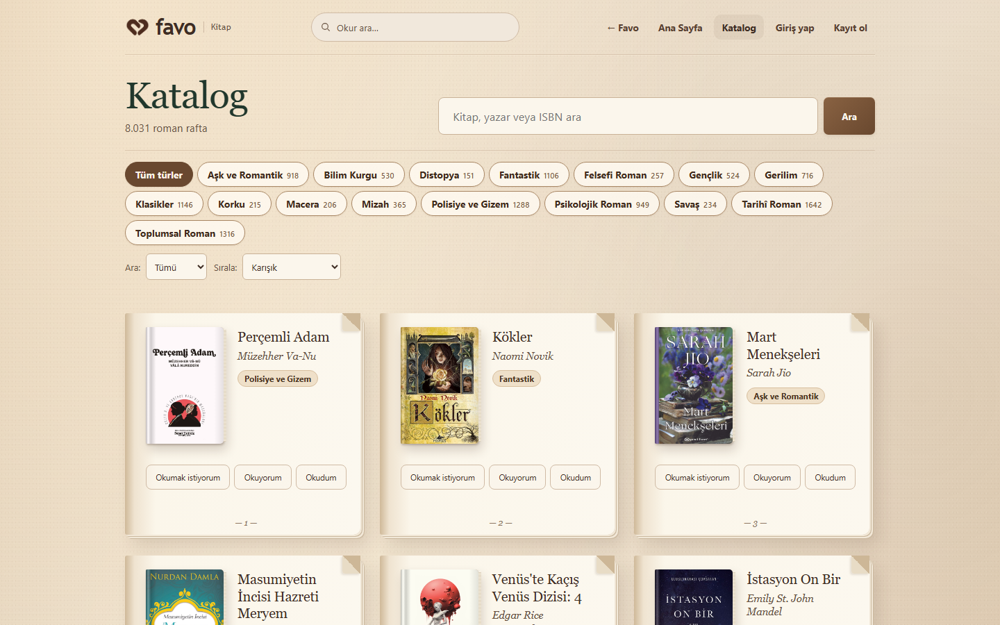
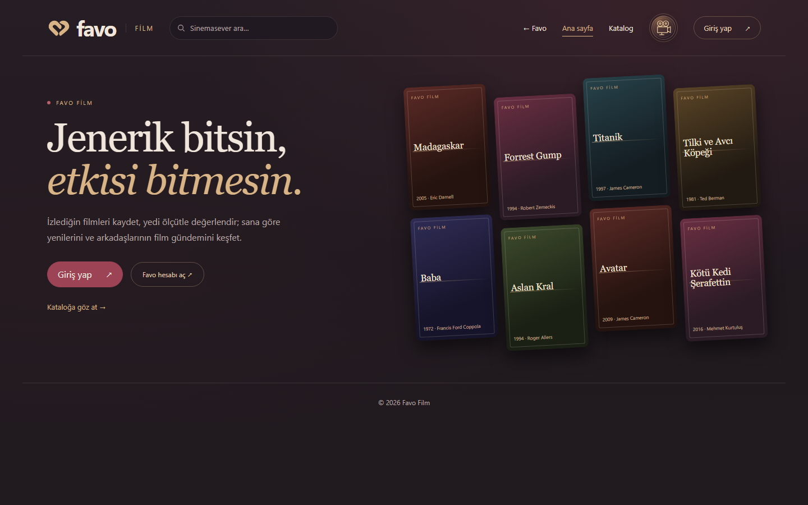
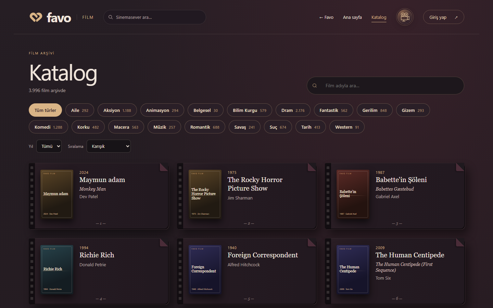

# Favo

**A book and movie discovery platform with one shared account across independent apps.**

[Türkçe](README.tr.md)

> This repository is a showcase. The source code is private.
> Code access for technical review is available on request:
> [LinkedIn](https://www.linkedin.com/in/ahmeterendinc) · dincahmet87@gmail.com

Favo is my personal project. Readers and movie fans keep shelves, rate titles on
seven criteria, follow each other and get personal recommendations. Each content
type is its own application. One account and one sign-in work across all of them.

| App | Status |
| --- | --- |
| Favo portal + identity service | Working |
| Books (`/kitap/`) | Working |
| Movies (`/film/`) | Working |
| TV series, anime, manga | Planned |

## Architecture

- **One origin for the browser.** A YARP reverse proxy serves the portal and routes
  `/kitap/` and `/film/` to separately built React apps and their APIs. No tokens
  travel in URLs and no cross-origin sign-in is needed.
- **One owner of identity.** `Favo.Identity.Api` is the only service that stores
  accounts and issues tokens. Access tokens are signed with **RS256**; the Books and
  Movie services validate them with the public key and never hold a signing secret.
- **Refresh tokens** live in a Secure, HttpOnly cookie; the access token is kept in
  memory only. Login endpoints are rate limited; optional Google sign-in is supported.
- **People service.** Nicknames, privacy, following and invitations are served from
  `/api/people`, so the social graph is shared between apps.
- **Each app owns its data.** Books uses its own PostgreSQL schemas per module;
  Movies keeps its catalog in a `movies` schema and its user data in SQLite.

## Books: a modular monolith

`Favo.Books.Api` is deployed as one unit but split into five modules:
Identity, Catalog, Reading, Profiles and Community.

- Vertical slices inside each module, Clean Architecture dependency direction,
  lightweight CQRS.
- A module never touches another module's `DbContext` or tables; modules talk
  through small explicit contracts in a shared kernel.
- Architecture tests enforce project references and forbid cycles.
- Design choices are recorded as Architecture Decision Records (7 ADRs).

## Features

- Catalog search that ignores Turkish characters and accents, genre and year filters.
- Personal shelves: five reading states for books (want to read, reading, read,
  on hold, dropped); watchlist / watching / watched for movies.
- Seven-criterion ratings with a weighted overall score.
- Profiles with privacy settings, follow network and people search.
- Personal recommendations from genres, liked authors or directors and the
  ratings of people you follow.
- Monthly and yearly reading and watching summaries.

## Data pipelines

- **Books:** Open Library search and background import jobs; only novels with a
  verified Turkish edition and cover are accepted.
- **Movies:** Catalog data from Wikidata (CC0) through an offline
  manifest → validation → `--apply` flow. Summaries are written by Favo, not copied;
  covers are generated typographically instead of using licensed posters.

## Quality

- xUnit unit and integration tests; integration tests run against throwaway
  PostgreSQL containers with **Testcontainers**.
- Cross-service integration checks start the real identity service next to the
  Movie API on an isolated database.
- Playwright browser tests for shared sign-in, sign-out across tabs and routing.
- ProblemDetails error responses, CSRF and redirect checks, Swagger in development.

## Tech stack

**Backend:** C#, .NET 10, ASP.NET Core Minimal APIs, Entity Framework Core,
YARP, JWT (RS256), PostgreSQL, SQLite
**Frontend:** React 19, TypeScript, Vite
**Testing:** xUnit, Testcontainers, Playwright
**Tooling:** Docker, Git, PowerShell build and publish scripts

## AI-assisted development

Favo was built with AI coding agents (Claude Code) as a daily tool, under my design
and review. Each repository carries agent instructions (`CLAUDE.md`) that fix
cross-repository contracts, ports and conventions, so changes stay consistent and
reviewable across three codebases. Architecture, data rules and verification
standards are mine; the agent speeds up implementation, tests and documentation.

## Screenshots

**Portal:** one entry point for every app.

**Books catalog:** genre filters with counts, accent-insensitive search.

**Movies home and catalog:** typographic covers generated by Favo.

---

© 2026 Ahmet Eren Dinç. All rights reserved. See [LICENSE](LICENSE).
