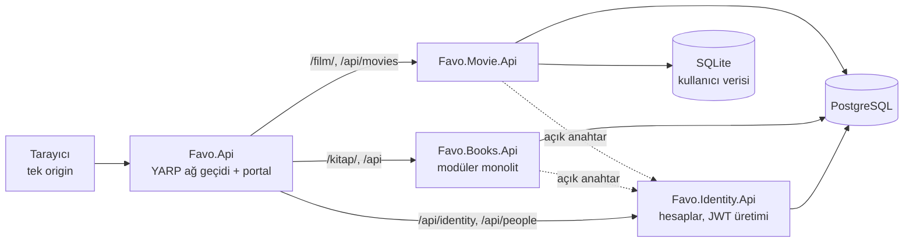
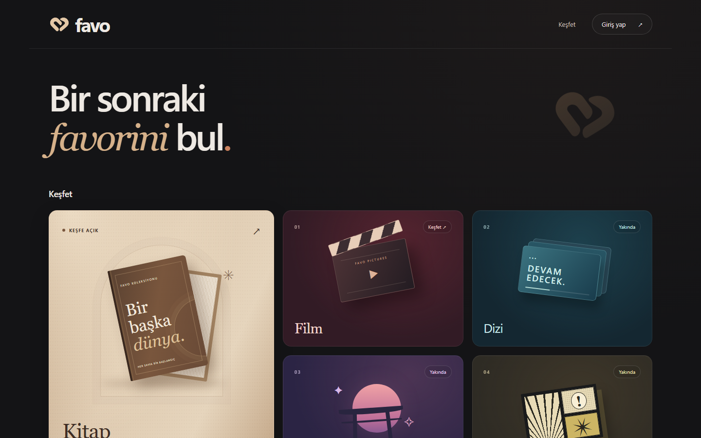
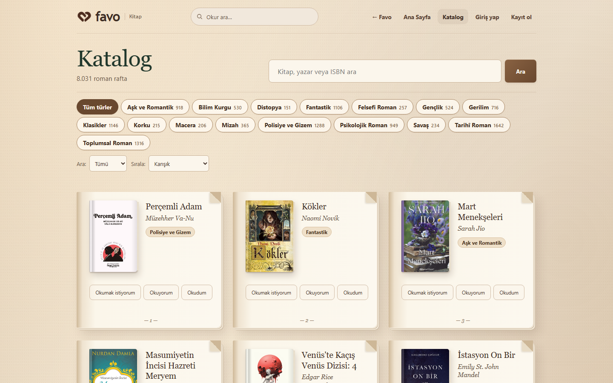
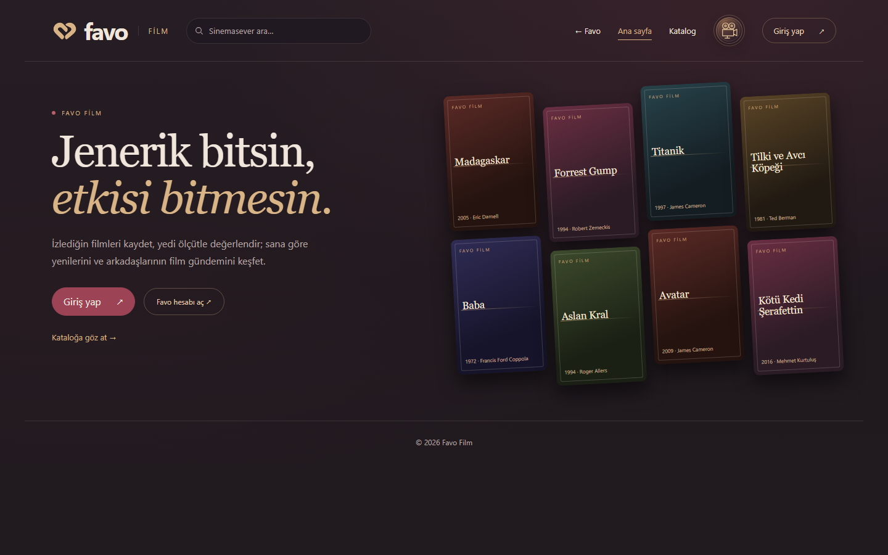
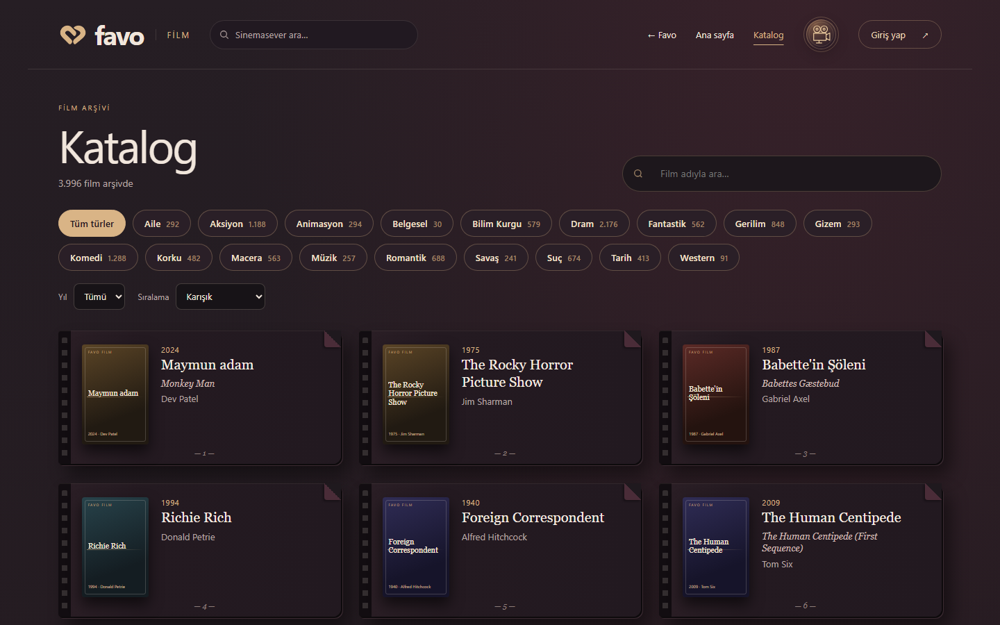

# Favo

**Tek hesapla çalışan, birbirinden bağımsız uygulamalardan oluşan kitap ve film keşif platformu.**

[English](README.md)

> Bu depo bir tanıtım deposudur; kaynak kod gizlidir.
> Teknik inceleme için kod erişimi talep üzerine verilir:
> [LinkedIn](https://www.linkedin.com/in/ahmeterendinc) · dincahmet87@gmail.com

Favo kişisel projemdir. Okurlar ve film severler raflarını tutar, eserleri yedi ölçüte
göre puanlar, birbirini takip eder ve kişisel öneriler alır. Her içerik türü ayrı bir
uygulamadır; tek hesap ve tek oturum hepsinde geçerlidir.

| Uygulama | Durum |
| --- | --- |
| Favo portalı + hesap servisi | Çalışıyor |
| Kitap (`/kitap/`) | Çalışıyor |
| Film (`/film/`) | Çalışıyor |
| Dizi, anime, manga | Planlandı |

## Mimari

- **Tarayıcı tek origin görür.** YARP ters vekil portalı sunar; `/kitap/` ve `/film/`
  isteklerini ayrı derlenen React uygulamalarına ve API'lerine yönlendirir. URL ile token
  taşınmaz, origin'ler arası giriş gerekmez.
- **Kimliğin tek sahibi var.** Hesapları tutan ve token üreten tek servis
  `Favo.Identity.Api`'dir. Erişim token'ları **RS256** ile imzalanır; Kitap ve Film
  servisleri token'ı açık anahtarla doğrular, imzalama sırrı tutmaz.
- **Refresh token** Secure ve HttpOnly çerezde, erişim token'ı yalnızca bellekte tutulur.
  Giriş uçlarında istek sınırlaması var; isteğe bağlı Google girişi destekleniyor.
- **Kişiler servisi.** Takma ad, gizlilik, takip ve davetler `/api/people` uçlarındadır;
  sosyal ağ uygulamalar arasında ortaktır.
- **Her uygulama kendi verisinin sahibidir.** Kitap her modül için ayrı PostgreSQL şeması
  kullanır; Film kataloğunu `movies` şemasında, kullanıcı verisini SQLite'ta tutar.

## Kitap: modüler monolit

`Favo.Books.Api` tek birim olarak yayınlanır ama beş modüle ayrılır:
Identity, Catalog, Reading, Profiles ve Community.

- Modül içinde dikey dilimler, Clean Architecture bağımlılık yönü, hafif CQRS.
- Bir modül başka bir modülün `DbContext`'ine veya tablolarına erişmez; modüller paylaşılan
  çekirdekteki küçük, açık sözleşmelerle konuşur.
- Mimari testler proje referanslarını denetler ve döngüsel bağımlılığı engeller.
- Tasarım kararları Mimari Karar Kayıtlarında (7 ADR) tutulur.

## Özellikler

- Türkçe karakter ve aksana duyarsız katalog araması, tür ve yıl filtreleri.
- Kişisel raflar: kitapta beş okuma durumu (okuyacağım, okuyorum, okudum, ara verdim,
  bıraktım); filmde izleyeceğim / izliyorum / izledim.
- Ağırlıklı genel puan üreten yedi ölçütlü değerlendirme.
- Gizlilik ayarlı profiller, takip ağı ve kişi arama.
- Tür, sevilen yazar veya yönetmen ve takip edilenlerin puanlarına dayalı kişisel öneriler.
- Aylık ve yıllık okuma ve izleme özetleri.

## Veri hatları

- **Kitap:** Open Library araması ve arka plan içe aktarma işleri; yalnızca doğrulanmış
  Türkçe baskısı ve kapağı olan romanlar kabul edilir.
- **Film:** Katalog verisi Wikidata'dan (CC0) çevrimdışı manifest → doğrulama → `--apply`
  akışıyla girer. Özetleri Favo yazar, kopyalanmaz; afiş yerine tipografik kapak üretilir.

## Kalite

- xUnit birim ve entegrasyon testleri; entegrasyon testleri **Testcontainers** ile geçici
  PostgreSQL kapsayıcılarında çalışır.
- Servisler arası kontroller gerçek hesap servisini Film API'sinin yanında, izole bir
  veritabanıyla başlatır.
- Ortak giriş, sekmeler arası çıkış ve yönlendirme için Playwright tarayıcı testleri.
- ProblemDetails hata yanıtları, CSRF ve yönlendirme kontrolleri, geliştirmede Swagger.

## Teknolojiler

**Backend:** C#, .NET 10, ASP.NET Core Minimal API, Entity Framework Core, YARP,
JWT (RS256), PostgreSQL, SQLite
**Ön yüz:** React 19, TypeScript, Vite
**Test:** xUnit, Testcontainers, Playwright
**Araçlar:** Docker, Git, PowerShell derleme ve yayın betikleri

## Yapay zekâ destekli geliştirme

Favo, tasarımı ve incelemesi bende olmak üzere, günlük araç olarak yapay zekâ kodlama
ajanlarıyla (Claude Code) geliştirildi. Her depoda depolar arası sözleşmeleri, portları ve
kuralları sabitleyen ajan talimatları (`CLAUDE.md`) bulunur; böylece üç kod tabanındaki
değişiklikler tutarlı ve incelenebilir kalır. Mimari, veri kuralları ve doğrulama
standartları bana aittir; ajan uygulamayı, testleri ve dokümantasyonu hızlandırır.

## Ekran görüntüleri

**Portal:** tüm uygulamalar için tek giriş noktası.

**Kitap kataloğu:** sayılarla tür filtreleri, aksana duyarsız arama.

**Film ana sayfası ve kataloğu:** Favo'nun ürettiği tipografik kapaklar.

---

© 2026 Ahmet Eren Dinç. Tüm hakları saklıdır. Bkz. [LICENSE](LICENSE).
